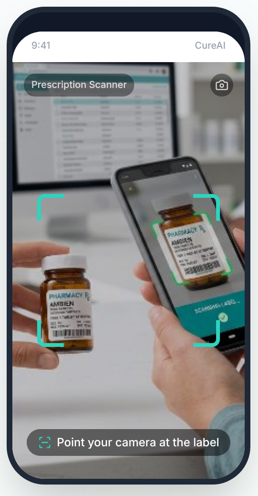
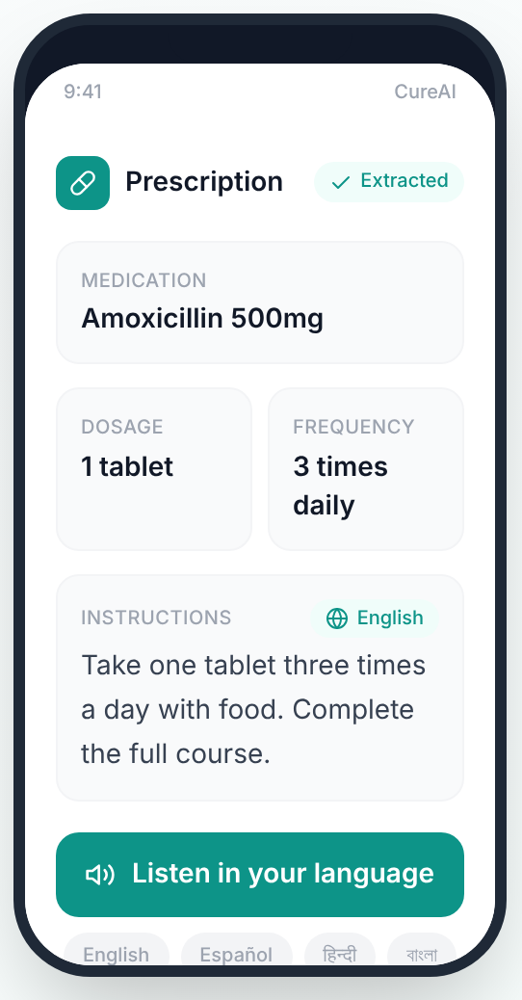
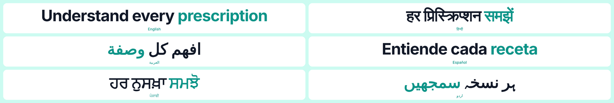
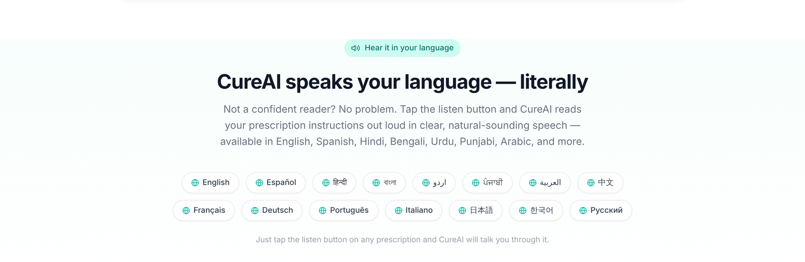
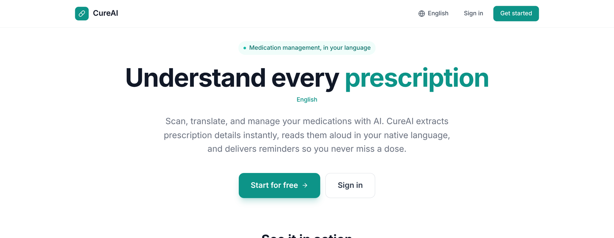
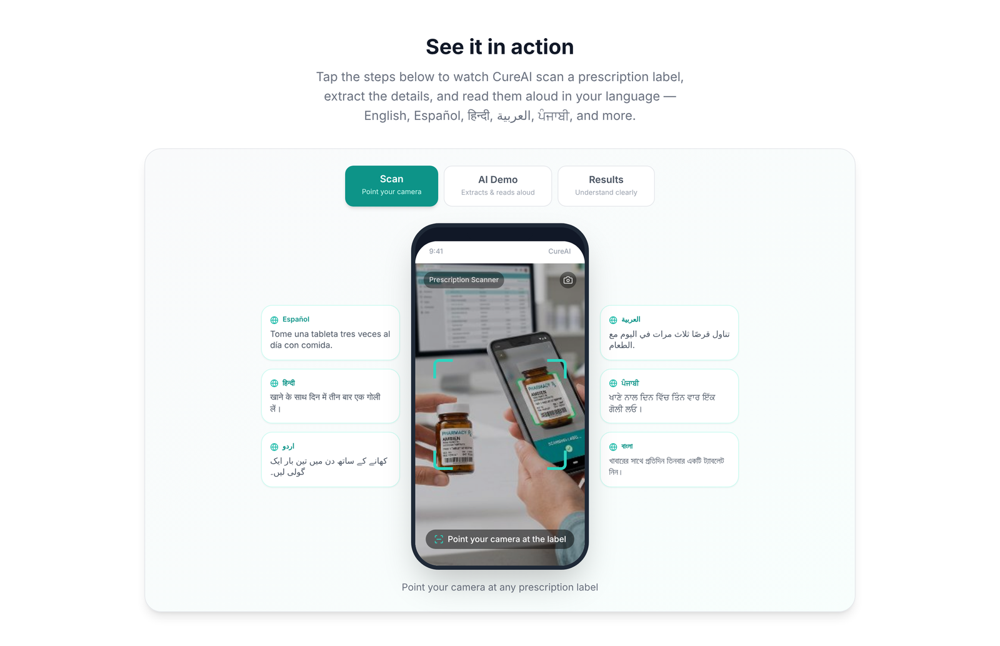
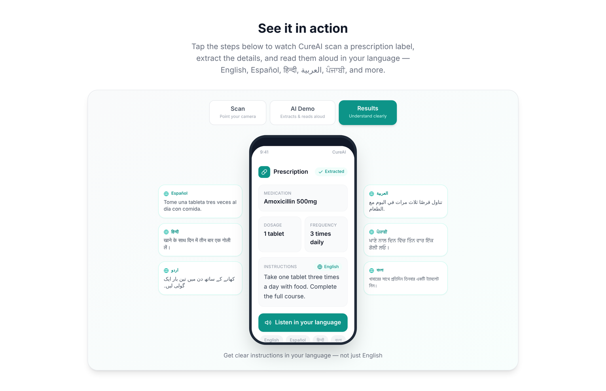
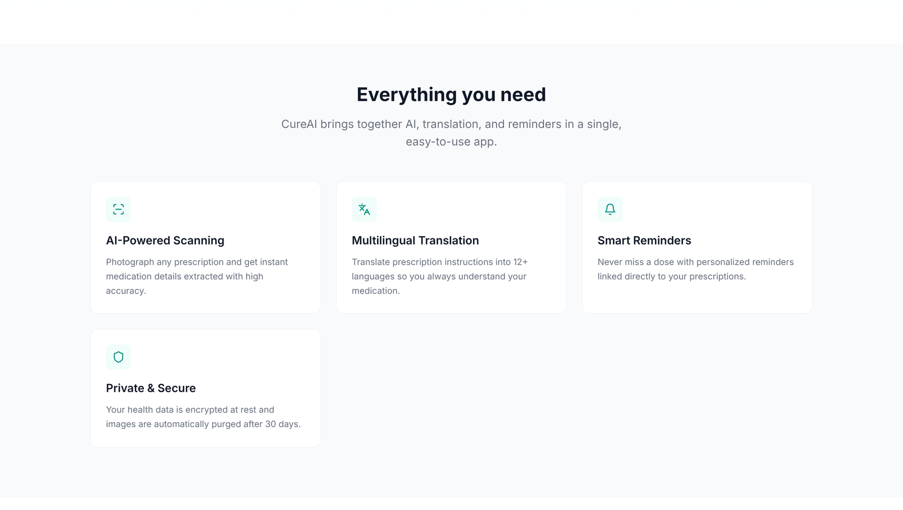

# 💊 CureAI

### Understand every prescription — in your own language.

CureAI scans a prescription label, pulls out the medication, dose and schedule, 
translates the instructions, and **reads them aloud** in the patient's native language.

https://github.com/user-attachments/assets/806290d0-ad6c-48c3-95e6-d022feb06643

▶ 38-second walkthrough of CureAI

---

## 🩺 The problem

A prescription is only as safe as the patient's ability to understand it.

- **28.5 million people** in the U.S. — about 9% of the population — have limited English proficiency ([KFF analysis of 2024 American Community Survey](https://www.kff.org/racial-equity-and-health-policy/overview-of-health-coverage-and-care-for-individuals-with-limited-english-proficiency/)).
- **27%** of adults with limited English proficiency who recently used health care say a language barrier made it **hard to fill a prescription or understand how to use it** ([2023 KFF Survey on Racism, Discrimination, and Health](https://www.kff.org/racial-equity-and-health-policy/overview-of-health-coverage-and-care-for-individuals-with-limited-english-proficiency/)).

Interpreters are rarely there when it matters most: at home, hours after the pharmacy visit, when a patient is deciding whether "three times a day" means with meals or every eight hours.

## 💡 Why I built this

My grandparents speak English, but reading a prescription label is a different challenge: small print, abbreviations, and instructions like "take three times daily" that leave room for doubt. I started thinking about how to make that easier for them. Then, at a pharmacy, I helped an Indian woman who couldn't read her prescription understand how to take her medication. In that moment I realized my grandparents' struggle wasn't unusual; it was shared by many patients, and it often goes unseen. I built CureAI so that no patient has to guess what their prescription says.

---

## ✨ See it work

<table>
<tr>
<td width="50%" align="center"><b>1 · Scan</b> Point the camera at any prescription label</td>
<td width="50%" align="center"><b>2 · Understand and listen</b> AI extracts drug, dose and frequency, then reads it aloud</td>
</tr>
<tr>
<td align="center"></td>
<td align="center"></td>
</tr>
</table>

### One label, every language

CureAI turns a single English instruction into clear, plain-language guidance for each patient:

| Language | What the patient reads and hears |
|---|---|
| English | Take one tablet three times a day with food. Complete the full course. |
| Español | Tome una tableta tres veces al día con comida. |
| हिन्दी (Hindi) | खाने के साथ दिन में तीन बार एक गोली लें। |
| বাংলা (Bengali) | খাবারের সাথে প্রতিদিন তিনবার একটি ট্যাবলেট নিন। |
| اردو (Urdu) | کھانے کے ساتھ دن میں تین بار ایک گولی لیں۔ |
| ਪੰਜਾਬੀ (Punjabi) | ਖਾਣੇ ਨਾਲ ਦਿਨ ਵਿੱਚ ਤਿੰਨ ਵਾਰ ਇੱਕ ਗੋਲੀ ਲਓ। |
| العربية (Arabic) | تناول قرصًا ثلاث مرات في اليوم مع الطعام. |

---

## 🧩 What CureAI does

| | Feature | Why it matters for patients |
|---|---|---|
| 📷 | **AI prescription scanning** | Reads the label so the patient doesn't have to decode abbreviations or small print. |
| 🌐 | **Multilingual translation** | Instructions in the language the patient actually thinks in. |
| 🔊 | **Read-aloud** | Helps patients with low literacy or poor eyesight, not just non-English speakers. |
| ⏰ | **Smart reminders** | Dose reminders tied to the scanned prescription, to support adherence. |
| 🔒 | **Privacy by design** | Health data encrypted at rest; label images automatically deleted after 30 days. |

### 🌍 15 languages, including the ones health systems often miss

English · Español · हिन्दी · বাংলা · اردو · ਪੰਜਾਬੀ · العربية · 中文 · Français · Deutsch · Português · Italiano · 日本語 · 한국어 · Русский

Right-to-left scripts (Arabic, Urdu) are fully supported.

<b>More screenshots</b>

 

**Landing page**

**Scan → Results walkthrough**

**Features**

---

## ⚠️ Patient safety and limitations

CureAI is built around one rule: **it should help a patient ask better questions, never replace the person who should answer them.**

- **Not a medical device.** CureAI is an educational and communication aid. It does not diagnose, prescribe or give medical advice.
- **The pharmacist is the source of truth.** Every result tells the patient to confirm instructions with their pharmacist or doctor.
- **AI can misread labels.** Handwriting, glare and look-alike drug names (e.g. hydroxyzine vs. hydralazine) are known risks. Low-confidence results should be flagged rather than shown as certain.
- **Machine translation is not certified medical translation.** It's meant to support understanding at home, not to replace a qualified interpreter during care.
- **Never upload real patient data to this repository.** All examples here use synthetic prescriptions.

## 🔐 Privacy

- No real patient data is stored in this repository.
- Uploaded label images are purged automatically after 30 days.
- Health data is encrypted at rest.

## 🧪 Validation

Testing on **synthetic** prescription labels is in progress, so results can be shared openly without using any patient's data.

<!--
When you have real results, delete this comment's start and end lines so the table shows.
Fill in only numbers you have actually measured.

| Test set | Labels | Drug name correct | Dose correct | Frequency correct |
|---|---|---|---|---|
| Printed pharmacy labels | [n] | [x%] | [x%] | [x%] |
| Handwritten prescriptions | [n] | [x%] | [x%] | [x%] |

**Translation review:** e.g. "Hindi and Urdu outputs reviewed by two native speakers; 2 phrasing issues fixed."
**Clinical feedback:** e.g. "Reviewed by a community pharmacist, who suggested adding a low-confidence warning."
-->

---

## 🛠 Built with

- **Frontend:** React · Tailwind CSS · Lucide icons, built and deployed with Bolt
- **Accessibility:** multilingual interface, right-to-left layout support, read-aloud for low-literacy users
<!-- - **AI:** [OCR / vision model] for label extraction · [translation service] · [text-to-speech service] -->

## Video Advertisement 

https://github.com/user-attachments/assets/a921efa6-bc14-4515-8f68-9357dc471001

### Try it live

👉 **[Open CureAI](https://app-development-5yjj.bolt.host/)** — no installation needed.

## 🗺 Roadmap

- [ ] Confidence score on every extracted field, with a "check with your pharmacist" flag when it's low
- [ ] Drug-interaction and allergy warnings from a trusted drug database
- [ ] Review of translations by native-speaking health professionals
- [ ] Pilot with a free clinic or community pharmacy and collect patient feedback
- [ ] Offline mode for patients with limited data plans

<!--
## 📚 What I learned

Add 3–5 bullets in your own words, then delete this comment's start and end lines.
Ideas: something that surprised you about how prescriptions are written · a safety issue you didn't anticipate · what feedback from a pharmacist, doctor or user changed · why plain language matters as much as translation.
-->

## 👤 About me

**Shalaal Siddiqui** 
Student, East Meadow High School · Aspiring physician

I want to become a physician who makes sure every patient understands their own care. Watching my grandparents struggle with their prescription labels, and helping a stranger at the pharmacy read hers, showed me that a language or literacy barrier can stand between a patient and safe treatment. CureAI is my first step toward closing that gap, and I hope to carry the same commitment into medicine: listening carefully, explaining clearly, and serving the communities that are most often overlooked.

📧 [shalaal.siddiqui@gmail.com](mailto:shalaal.siddiqui@gmail.com)

---

CureAI is an educational project and not a medical device. Always confirm medication instructions with your pharmacist or doctor. 
Released under the <a href="LICENSE">MIT License</a>.

